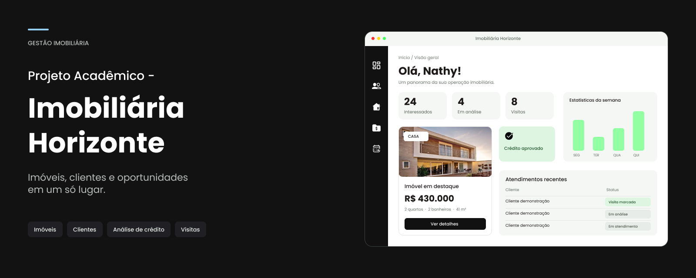

# Horizonte — Sistema Imobiliário

<p align="center">
  
</p>


**Projeto acadêmico de Programação Orientada a Objetos (POO) em Java, expandido para uma aplicação web com Spring Boot, HTML, CSS e JavaScript.**

O **Horizonte** é um sistema imobiliário demonstrativo desenvolvido para organizar informações de imóveis e clientes, realizar simulações financeiras e apresentar uma análise de crédito simplificada. O projeto começou com classes Java e execução em console, atendendo aos conceitos estudados em POO, e foi ampliado com uma API REST para permitir acesso por uma interface web publicada.

> **Atenção:** o sistema tem finalidade acadêmica. As análises de crédito, os registros cadastrais e os resultados financeiros são demonstrativos. Não existe consulta real a bancos, birôs de crédito ou bases oficiais.

## Acessos

- **Aplicação web:** https://nahhay.github.io/horizonte-academico/index.html
- **Código-fonte:** https://github.com/nahhay/horizonte-academico
- **Backend publicado:** https://horizonte-academico.onrender.com
- **Verificação da API:** https://horizonte-academico.onrender.com/api/saude
- **Projeto Visual:** https://www.figma.com/design/eQK4zNJVQkD7DUjUtZQlpQ/Projeto-Horizonte?m=auto&t=JJiHJ4BMqipaOqnZ-6 

O frontend utiliza o GitHub Pages, enquanto a API Java está hospedada no Render. A aplicação foi publicada usando alternativas gratuitas. Como o servidor utiliza um plano gratuito, pode levar algum tempo para responder após um período de inatividade.

---

## 1. Contexto e objetivo

O projeto foi desenvolvido no contexto da graduação em **Engenharia de Software na Universidade Federal de Mato Grosso do Sul (UFMS)**, como atividade de **Linguagem de Programação Orientada a Objetos**.

A proposta inicial era construir um programa em Java que recebesse dados, processasse informações e apresentasse resultados, demonstrando os conceitos essenciais da disciplina: classes, objetos, abstração, encapsulamento, herança, interfaces, polimorfismo, coleções, genéricos, ordenação e tratamento de exceções.

Foi escolhido o contexto imobiliário por permitir a integração desses conceitos em situações concretas. Um imóvel possui características e valores; um cliente tem dados cadastrais e renda; o corretor conduz uma avaliação; a simulação calcula condições de pagamento; e o resultado reúne as etapas da análise.

O objetivo **não** foi reproduzir integralmente a operação de uma imobiliária ou de uma instituição financeira, mas construir um exemplo coeso, testável e compreensível, no qual as regras sejam executadas pelas classes Java.

### Objetivo geral

Desenvolver um sistema imobiliário em Java com estrutura orientada a objetos, validação de dados, cadastro de informações, simulação financeira e análise de crédito demonstrativa, posteriormente integrado a uma interface web sem transferir as regras de negócio para o JavaScript.

### Objetivos específicos

1. Modelar o domínio com classes, relacionamentos, interface e classe abstrata.
2. Organizar imóveis e clientes em coleções genéricas.
3. Validar informações e tratar entradas inválidas.
4. Executar simulações e análises usando regras implementadas em Java.
5. Testar as funcionalidades pelo console.
6. Representar a estrutura por um diagrama de classes UML.
7. Expor as funcionalidades por uma API REST.
8. Disponibilizar uma interface web que utilize os resultados da API.
9. Publicar o projeto sem utilizar um serviço pago.

---

## 2. Evolução do desenvolvimento

O Horizonte foi construído por etapas, preservando o código Java como núcleo do sistema.

### Etapa 1 — Modelagem orientada a objetos

A primeira etapa foi identificar os elementos principais do domínio e separar as responsabilidades das classes. A modelagem considerou pessoas, clientes, imóveis, registros de situação cadastral, simulações financeiras, etapas de análise e resultados.

Nessa fase também foram definidos os relacionamentos entre classes, a interface de análise, o repositório genérico e as validações.

### Etapa 2 — Aplicação em console

Após a modelagem, foi criada uma aplicação para execução pelo terminal, com uma classe `Teste` contendo `main`. Essa etapa permitiu demonstrar o fluxo de entrada, processamento e saída, além de testar diferentes cadastros, consultas, simulações, análises e casos inválidos.

O console foi importante para verificar a lógica independentemente de qualquer interface gráfica.

### Etapa 3 — Estudo de alternativas de interface

Com as regras funcionando em Java, foram consideradas formas de tornar a aplicação mais acessível visualmente, entre elas uma interface em JavaFX e uma interface baseada em HTML, CSS e JavaScript.

A decisão final foi utilizar uma interface web conectada ao backend Java. Dessa forma, a interface apresenta os dados e envia as solicitações, enquanto as classes Java continuam responsáveis pelos cálculos, validações e decisões.

### Etapa 4 — API REST

Foi acrescentado o **Spring Boot** para disponibilizar as funcionalidades Java por meio de endpoints HTTP. A classe `Api` recebe solicitações da interface, utiliza as classes existentes e devolve resultados que podem ser exibidos no navegador.

Esse passo permitiu reaproveitar o domínio orientado a objetos em uma aplicação web, em vez de reimplementar a análise financeira em JavaScript.

### Etapa 5 — Publicação

O projeto foi colocado no GitHub, com frontend e backend separados. Os arquivos web foram publicados com **GitHub Pages**, e a API Java foi hospedada no **Render**, utilizando configuração de execução compatível com Java e o projeto Spring Boot.

Depois da primeira publicação, foram feitos ajustes na comunicação com a API, no tratamento de respostas e na consistência dos cálculos apresentados.

---

## 3. Funcionalidades

### Gestão de imóveis

- Cadastro de imóveis com endereço, bairro, tipo, finalidade, quantidade de quartos e banheiros, área e preço.
- Listagem e apresentação dos imóveis cadastrados.
- Remoção de imóveis.
- Reorganização dos códigos dos imóveis após a exclusão, acompanhada do ajuste de referências mantidas nos cadastros de clientes.
- Validação dos dados recebidos, evitando informações incompatíveis com as regras do sistema.
- Organização e comparação de imóveis usando os recursos de Java previstos na disciplina.

### Gestão de clientes

- Cadastro de nome, CPF, renda e referência opcional a um imóvel.
- Validação do CPF e das informações cadastradas.
- Verificação para impedir dois clientes com o mesmo CPF na coleção.
- Consulta e apresentação dos clientes cadastrados.
- Remoção de clientes pelo CPF.
- Atualização do status do cliente durante a análise.

### Simulação financeira

- Cálculo da entrada e do valor a financiar.
- Cálculo de parcela estimada usando o **Sistema Price**.
- Apresentação do prazo, da taxa utilizada e da renda necessária estimada.
- Comparação entre parcela e limite de comprometimento da renda.
- Indicação sobre a compatibilidade da renda com a regra demonstrativa do projeto.

### Análise cadastral e de crédito

- Localização do cliente e do imóvel selecionados.
- Consulta a registros **fictícios**, usados para demonstrar diferentes situações cadastrais.
- Verificação das etapas de cadastro e capacidade financeira.
- Geração de resultado com protocolo, data, status e motivo da decisão.
- Apresentação de etapas individuais, indicando quais verificações foram atendidas.

**Importante:** o resultado não representa pré-aprovação ou aprovação de financiamento real. Um banco considera critérios adicionais que não fazem parte deste trabalho.

---

## 4. Programação Orientada a Objetos aplicada

A estrutura acadêmica é a base de todo o projeto. Os principais conceitos aparecem nas classes e em suas relações.

| Conceito | Aplicação no Horizonte |
| --- | --- |
| **Classe abstrata** | `Pessoa` centraliza características compartilhadas, como nome e CPF. |
| **Herança** | `Cliente` estende `Pessoa`, reutilizando os atributos e comportamentos comuns. |
| **Interface** | `Analise` define a operação `analisar(Cliente, Imovel)`. |
| **Polimorfismo** | `Corretor` implementa `Analise`, permitindo utilizar a operação definida pelo contrato da interface. |
| **Encapsulamento** | Os atributos são protegidos e acessados por construtores, métodos e operações de validação. |
| **Genéricos** | `Repositorio<T>` armazena objetos de tipos diferentes sem duplicar toda a lógica de gerenciamento. |
| **Coleções** | `List` e `ArrayList` armazenam imóveis, clientes, registros e etapas da análise. |
| **Ordenação** | Comparação de imóveis e organização de dados para apresentação. |
| **Tratamento de exceções** | Entradas inválidas e operações inconsistentes geram erros controlados, em vez de resultados silenciosamente incorretos. |
| **Entrada, processamento e saída** | A execução em console e as rotas HTTP recebem dados, chamam as classes Java e apresentam os resultados. |

### 4.1 Principais classes

| Classe | Responsabilidade |
| --- | --- |
| `Pessoa` | Abstração de dados comuns de uma pessoa. |
| `Cliente` | Representação do cliente, incluindo renda, imóvel associado e status. |
| `Imovel` | Características e dados financeiros de um imóvel; oferece recursos de comparação. |
| `Repositorio<T>` | Inclusão, listagem, remoção e organização em memória de objetos do tipo `T`. |
| `Analise` | Contrato da funcionalidade de análise. |
| `Corretor` | Execução das etapas cadastrais e financeiras; implementação de `Analise`. |
| `Registro` | Situação cadastral e pontuação fictícia associadas a um CPF. |
| `Situacao` | Representação dos estados cadastrais utilizados na análise. |
| `Simulacao` | Cálculo da entrada, financiamento, prestação e condição de renda. |
| `Etapa` | Representação de uma verificação individual da análise. |
| `Resultado` | Reunião de protocolo, data, decisão, motivo e etapas. |
| `Teste` | Classe da aplicação em console com `main`, utilizada na demonstração acadêmica. |
| `Api` | Recebimento das requisições web e comunicação com as classes Java. |
| `HorizonteApplication` | Inicialização do aplicativo Spring Boot. |

A existência de `Api` e `HorizonteApplication` não substitui a estrutura de POO. Essas classes foram acrescentadas para possibilitar a execução web do domínio já desenvolvido.

### 4.2 Herança e abstração

`Pessoa` reúne atributos e validações comuns. `Cliente` especializa essa representação para as necessidades do sistema imobiliário, acrescentando renda, estado de atendimento e vínculo com imóvel. Assim, evita-se repetir os dados básicos de uma pessoa em classes especializadas.

### 4.3 Interface e polimorfismo

A interface `Analise` estabelece a operação de análise de um cliente em relação a um imóvel. `Corretor` implementa essa interface e fornece o comportamento concreto.

Essa separação diferencia **o que deve ser realizado** (contrato) de **como a verificação acontece** (implementação).

### 4.4 Repositório genérico

`Repositorio<T>` é reutilizado com tipos distintos, como `Repositorio<Imovel>` e `Repositorio<Cliente>`. O mesmo mecanismo básico de armazenamento serve a entidades diferentes.

Os dados são guardados em coleções Java **na memória**, não em tabelas de banco de dados. O repositório genérico é uma estrutura acadêmica de gerenciamento de objetos, e não uma camada de persistência permanente.

### 4.5 Coleções, comparações e ordenações

O projeto utiliza coleções para administrar conjuntos de objetos e para registrar as várias etapas de cada análise. A comparação e ordenação de imóveis apoiam a organização das informações apresentadas aos usuários.

### 4.6 Validações e exceções

O sistema faz validações para dados cadastrais e financeiros, incluindo exemplos como CPF inválido, nome não informado, preço ou renda incompatíveis e dados incorretos de imóveis.

Em situações de erro, as classes podem lançar `IllegalArgumentException`. Na interface HTTP, a API converte determinadas exceções em respostas com código **400 (Bad Request)** e uma mensagem explicativa. Também há tratamento para corpos de requisição inválidos ou incompletos.

---

## 5. Diagrama de classes UML

O diagrama faz parte da documentação acadêmica e representa os relacionamentos entre os componentes do sistema. Sua leitura permite identificar, por exemplo:

- A generalização entre `Cliente` e `Pessoa`.
- A implementação da interface `Analise` por `Corretor`.
- A utilização de objetos `Cliente` e `Imovel` na análise.
- O uso de `Simulacao`, `Registro`, `Etapa` e `Resultado` para compor a decisão.
- O emprego de `Repositorio<T>` para gerenciar coleções.
- A separação entre a execução em console (`Teste`) e o acesso web (`Api`).

**Na entrega:** anexar o diagrama UML final em PDF ou imagem, identificando os atributos, métodos e associações efetivamente presentes na versão entregue. Como o console e a API são formas diferentes de acesso ao mesmo domínio, o diagrama pode apresentar os dois pontos de entrada ou distingui-los em uma observação.

---

## 6. Simulação pelo Sistema Price

Para estimar o valor mensal de um financiamento, o projeto utiliza o **Sistema Price**, cujo cálculo depende do valor financiado, da taxa de juros por período e do número de parcelas.

A fórmula geral é:

\[
PMT = PV \times \frac{i}{1-(1+i)^{-n}}
\]

Onde:

- `PMT`: valor estimado da prestação mensal;
- `PV`: valor financiado, depois de descontada a entrada;
- `i`: taxa de juros mensal;
- `n`: quantidade de prestações.

Na implementação do projeto, os parâmetros são definidos na classe `Simulacao`. A versão utilizada durante o desenvolvimento considerou **entrada de 20%**, **juros de 0,8% ao mês**, **360 meses** e **limite de 30% da renda** para a simulação de financiamento. Esses parâmetros são **didáticos** e podem ser alterados no código.

O cálculo serve para demonstrar a regra matemática e comparar o valor da parcela com a renda informada. Ele não inclui necessariamente todos os custos que compõem um financiamento bancário real, como seguros, tributos, tarifas e condições individuais.

### Parcela, limite da renda e renda necessária

Essas informações têm funções diferentes:

- **Parcela:** valor mensal estimado pelo Sistema Price.
- **Limite da renda:** parcela máxima considerada aceitável pela regra financeira do projeto.
- **Renda necessária:** renda mínima calculada a partir da parcela e do percentual máximo permitido.

Exemplo conceitual: se a parcela é de R$ 1.200,00 e o limite de comprometimento é 30%, a renda mínima estimada é R$ 4.000,00.

Na API, o valor de `rendaNecessaria` é arredondado **para cima em duas casas decimais** usando `BigDecimal` e `RoundingMode.CEILING`. Essa decisão evita informar uma renda mínima arredondada para baixo, o que poderia causar inconsistências entre o valor exibido e o critério aplicado.

---

## 7. Como funciona a análise de crédito

O processo de análise reúne diferentes verificações:

1. **Identificação:** o sistema recebe o cliente e o imóvel.
2. **Validação cadastral:** os dados do cliente devem atender às regras definidas.
3. **Registro demonstrativo:** o sistema consulta situações cadastrais previamente cadastradas em memória. Para fins de exercício, também existe um comportamento padrão para CPFs sem registro específico.
4. **Verificação financeira:** a aplicação calcula a parcela ou considera o aluguel, conforme a finalidade do imóvel, e compara esse valor ao limite previsto.
5. **Resultado:** é gerado um objeto contendo protocolo, data, aprovação ou reprovação, motivo e etapas percorridas.

A lógica distingue a análise de **financiamento** da análise de **aluguel**. No caso do financiamento, é usada a simulação Price e o percentual de renda definido na classe `Simulacao`. Para aluguel, a análise compara o valor do aluguel com um terço da renda, conforme a regra demonstrativa implementada.

O sistema **não acessa** dados reais do Serasa, SPC, Receita Federal, bancos ou outros serviços de análise de crédito. Os estados e pontuações cadastrais são recursos de simulação do próprio projeto.

---

## 8. Arquitetura da aplicação web

A versão web mantém o Java como fonte das regras do sistema.

```text
                  USUÁRIO
                     |
                     v
             NAVEGADOR WEB
        HTML + CSS + JavaScript
             (GitHub Pages)
                     |
                     | Requisições HTTP / JSON
                     v
             API REST — JAVA
               (Spring Boot)
                  (Render)
                     |
          +----------+----------+
          |          |          |
       Cadastro   Simulação   Análise
          |          |          |
          +----------+----------+
                     |
              Classes de POO
                     |
        Repositorio<T> / List / ArrayList
                 (memória)
```

### Frontend

O frontend utiliza:

- **HTML:** conteúdo, estrutura dos formulários e elementos visuais.
- **CSS:** aparência, layout, organização visual e adaptação da interface.
- **JavaScript:** eventos da página, leitura de campos, envio de requisições com `fetch`, apresentação de respostas e mensagens.

O JavaScript **não é a fonte autoritativa dos cálculos de financiamento, da decisão de crédito ou das validações de domínio**. Seu papel é comunicar-se com a API e atualizar a interface. Ele pode conter validações de apresentação e formatação, mas o backend verifica os dados recebidos.

### Backend

O backend utiliza **Java 21 e Spring Boot** para disponibilizar endpoints que recebem e devolvem informações em JSON. A classe `Api` utiliza objetos das classes originais, como `Corretor`, `Simulacao`, `Cliente`, `Imovel` e `Repositorio<T>`.

A API também configura CORS para permitir requisições da aplicação hospedada no GitHub Pages e de ambientes locais de desenvolvimento.

### Sem banco de dados

A aplicação utiliza armazenamento **temporário em memória**. Isso significa que os dados criados podem ser perdidos quando o processo do servidor reinicia ou quando a hospedagem inicia uma nova instância.

A ausência de banco de dados foi uma decisão consciente de escopo: o objetivo é demonstrar POO, integração e execução web, sem acrescentar autenticação, infraestrutura de persistência ou serviços pagos.

---

## 9. API REST

A aplicação expõe as rotas abaixo por meio de `Api.java`.

| Método | Endpoint | Finalidade |
| --- | --- | --- |
| `GET` | `/` | Redireciona para a aplicação web. |
| `GET` | `/api/saude` | Verifica se o backend está respondendo. |
| `GET` | `/api/imoveis` | Lista os imóveis cadastrados. |
| `GET` | `/api/dados` | Retorna imóveis e clientes. |
| `POST` | `/api/imoveis` | Cadastra um imóvel. |
| `DELETE` | `/api/imoveis/{id}` | Remove um imóvel. |
| `POST` | `/api/clientes` | Cadastra um cliente. |
| `DELETE` | `/api/clientes/{cpf}` | Remove um cliente. |
| `POST` | `/api/simular` | Executa a simulação financeira. |
| `POST` | `/api/analisar` | Realiza a análise de cliente e imóvel. |

### Exemplo: cadastrar imóvel

**Requisição:** `POST /api/imoveis`

```json
{
  "endereco": "Rua Exemplo, 100",
  "bairro": "Centro",
  "tipo": "Casa",
  "finalidade": "Comprar",
  "quartos": 3,
  "banheiros": 2,
  "area": 120,
  "preco": 182000
}
```

### Exemplo: cadastrar cliente

**Requisição:** `POST /api/clientes`

```json
{
  "nome": "Cliente Exemplo",
  "cpf": "52998224725",
  "renda": 5000,
  "imovel": 1
}
```

*CPF utilizado apenas como dado de teste demonstrativo.*

### Exemplo: simular financiamento

**Requisição:** `POST /api/simular`

```json
{
  "valor": 182000,
  "renda": 5000
}
```

A resposta contém, entre outros campos, `entrada`, `financiado`, `parcela`, `prazo`, `cabe`, `rendaNecessaria`, `entradaPercentual`, `limitePercentual`, `taxaMensal` e `taxaAnual`.

### Exemplo: solicitar análise

**Requisição:** `POST /api/analisar`

```json
{
  "cpf": "52998224725",
  "codigo": 1
}
```

A resposta inclui o objeto `resultado`, com a decisão e suas etapas, além do `status` do cliente.

### Tratamento de falhas

Requisições inválidas podem retornar **HTTP 400** com uma mensagem de erro. Exemplos incluem cadastro duplicado, imóvel inexistente, cliente não encontrado e informações incompletas.

A página também precisa lidar com falhas de comunicação, como quando o servidor do Render está iniciando ou temporariamente indisponível.

---

## 10. Estrutura do repositório

A estrutura pública reúne a parte web e o backend Java:

```text
horizonte-academico/
├── docs/
│   └── ... arquivos HTML, CSS, JavaScript e recursos web
├── Horizonte/
│   └── backend/
│       └── ... projeto Spring Boot e classes Java
└── README.md                  # documentação deste projeto
```

As classes do domínio ficam no projeto Java e incluem `Pessoa`, `Cliente`, `Imovel`, `Corretor`, `Analise`, `Registro`, `Situacao`, `Simulacao`, `Resultado`, `Etapa` e `Repositorio`.

> O projeto de console, especialmente a classe `Teste` com `main`, integra a entrega acadêmica. Caso não esteja incluído na mesma pasta publicada da versão Spring Boot, deve acompanhar os arquivos da entrega da disciplina, junto ao diagrama UML.

---

## 11. Executando o projeto

### 11.1 Acessar a versão publicada

Abra:

https://nahhay.github.io/horizonte-academico/index.html

A aplicação web utiliza a API hospedada em:

https://horizonte-academico.onrender.com

Se a página carregar antes do backend, aguarde a API voltar a responder e atualize a interface.

### 11.2 Executar a versão Java em console

Para avaliação acadêmica, abra o projeto de console no IntelliJ IDEA ou em outra IDE com suporte a Java.

1. Confira se os arquivos Java estão no mesmo projeto e com os pacotes configurados corretamente.
2. Localize a classe `Teste`.
3. Execute seu método `main(String[] args)`.
4. Utilize as opções do console para testar os cadastros, listagens, ordenação, simulação e análise.

Essa execução permite avaliar os conceitos da disciplina sem depender do navegador ou da conexão com a hospedagem.

### 11.3 Executar o backend localmente

**Pré-requisitos:** JDK 21 e os recursos de build configurados no projeto Spring Boot.

Abra a pasta:

```text
Horizonte/backend
```

Execute a classe `HorizonteApplication` pela IDE ou utilize o comando de execução definido para o projeto Maven. Por exemplo, em um ambiente com Maven instalado:

```bash
mvn spring-boot:run
```

O endereço local dependerá da porta configurada pela aplicação. Para testar a saúde da API, consulte `/api/saude` nessa porta.

### 11.4 Executar o frontend localmente

Abra os arquivos da pasta `docs` por meio de um servidor local de desenvolvimento. Para testar a comunicação com uma API local, ajuste o endereço do backend configurado no JavaScript.

Não é necessário instalar Spring Boot no navegador: o navegador executa HTML, CSS e JavaScript, enquanto o servidor executa Java.

---

## 12. Testes e verificações

O trabalho foi desenvolvido e revisado com cenários válidos e inválidos, tanto para demonstrar conceitos de POO quanto para verificar a integração web.

### Casos de teste do domínio

| Cenário | Comportamento esperado |
| --- | --- |
| CPF válido | Permitir prosseguir com o cadastro. |
| CPF inválido | Rejeitar o dado. |
| CPF já existente | Impedir duplicação do cliente. |
| Nome ou dados obrigatórios incorretos | Exibir erro de validação. |
| Preço, renda, área ou quantidades incompatíveis | Rejeitar entradas inválidas conforme as regras das classes. |
| Imóvel inexistente | Impedir a associação ou análise correspondente. |
| Simulação de financiamento | Calcular entrada, saldo financiado, parcela e renda necessária. |
| Renda abaixo do limite | Apresentar resultado incompatível com a regra financeira. |
| Renda compatível com a parcela | Apresentar resultado compatível, se as demais etapas forem atendidas. |
| Situação cadastral com restrição | Reprovar na etapa cadastral simulada. |
| Remoção de imóvel | Reorganizar códigos e referências dependentes. |
| Falha na comunicação web | Informar a falha, sem apresentar dados inventados. |

### Ajustes realizados durante o desenvolvimento

**Precisão da renda mínima.** Durante os testes, foi observada uma diferença de um centavo em uma condição de aprovação de renda. A resposta da API passou a arredondar a renda necessária para cima, com duas casas decimais, evitando exibir um limite menor que o exigido pela regra.

**Cadastro duplicado.** Foram revisados os fluxos de salvamento e os cuidados necessários quando um botão é acionado várias vezes, para evitar registros involuntariamente repetidos. O backend também verifica CPF já cadastrado para clientes.

**Conversão e exibição de números.** A integração exigiu atenção a valores monetários, separadores decimais, campos vazios e resultados inválidos, incluindo a prevenção de exibição de `NaN`.

**Publicação e caminhos.** A primeira configuração do GitHub Pages exigiu ajuste na localização dos arquivos web e no endereço consumido pelo JavaScript. Após a integração, a interface passou a utilizar a API publicada.

**Mensagens de erro.** As operações precisam oferecer retorno compreensível quando informações estão incorretas ou quando uma requisição não pode ser concluída.

Esses ajustes fazem parte da evolução do trabalho: além de implementar o funcionamento esperado, foi necessário confrontar resultados, identificar causas e corrigir problemas de integração.

---

## 13. Decisões de projeto

### Por que não deixar a lógica no JavaScript?

Porque a proposta acadêmica é demonstrar a lógica implementada em **Java**. Reproduzir o cálculo e a decisão de crédito somente no frontend enfraqueceria esse objetivo e poderia criar comportamentos diferentes entre console e navegador.

### Por que usar Spring Boot?

O framework possibilitou expor as funcionalidades existentes por meio de HTTP e JSON, conectando o código Java a uma interface web.

### Por que usar GitHub Pages e Render?

O GitHub Pages permite publicar arquivos estáticos, como HTML, CSS e JavaScript. Já o Render permite executar o servidor Java. Essa separação foi adequada porque o GitHub Pages, sozinho, não executa uma aplicação Spring Boot.

### Por que não usar banco de dados?

O foco é a organização do código, a demonstração de POO e a comunicação entre frontend e backend. O armazenamento em memória é suficiente para demonstrações, embora não seja apropriado para um sistema imobiliário real com dados permanentes.

### Por que manter a versão em console?

Porque ela mostra diretamente a entrada, o processamento e a saída do programa Java, sem depender de uma camada visual. A versão web é uma extensão do trabalho, e não uma substituição dos fundamentos apresentados na disciplina.

---

## 14. Limitações

Este é um projeto acadêmico e, por isso, possui limites deliberados:

- **Não há banco de dados:** os registros armazenados no processo do servidor não são persistentes.
- **Não há autenticação ou autorização:** a aplicação não foi desenvolvida para armazenar dados pessoais reais de usuários externos.
- **Não há consulta a serviços financeiros:** score e situação cadastral fazem parte de dados fictícios.
- **A simulação não é proposta bancária:** não incorpora todos os fatores e custos que seriam considerados numa operação real.
- **Os serviços gratuitos podem ficar indisponíveis ou hibernar:** a primeira requisição pode demorar.
- **O sistema não substitui a análise jurídica, documental ou financeira de um profissional.**
- **Não há compromisso de disponibilidade contínua:** a publicação tem finalidade de apresentação e portfólio acadêmico.

Para demonstrar o projeto, utilize **dados fictícios**, evitando inserir CPFs, renda e outras informações pessoais reais.

---

## 15. Possíveis evoluções

Fora do escopo desta entrega, o sistema poderia ser expandido para incluir persistência em banco de dados, autenticação, perfis de acesso, testes automatizados, cadastro mais completo de imóveis e clientes, filtros avançados e documentação de API gerada automaticamente.

Essas melhorias **não** fazem parte dos requisitos declarados como concluídos nesta versão.

---

## 16. Relação com os requisitos da disciplina

| Requisito acadêmico | Evidência no projeto |
| --- | --- |
| Pelo menos uma interface | `Analise`. |
| Pelo menos uma classe abstrata | `Pessoa`. |
| Três ou mais classes concretas | `Cliente`, `Imovel`, `Corretor`, `Simulacao` e outras. |
| Herança | `Cliente` herda de `Pessoa`. |
| Encapsulamento | Atributos e métodos das classes do domínio. |
| Polimorfismo | Contrato `Analise` implementado por `Corretor`. |
| Genéricos | `Repositorio<T>`. |
| Coleções | `List` e `ArrayList`. |
| Ordenação | Comparação e organização dos imóveis. |
| Tratamento de erros | Validações e exceções em Java. |
| Entrada, processamento e saída | Classe `Teste` no console; requisições e respostas na versão web. |
| Diagrama UML | Representação das classes e dos relacionamentos. |
| Demonstração | Execução em console e acesso à versão publicada. |

A API REST, a interface web e o deploy representam uma **ampliação voluntária** do exercício, sem mudar o objetivo central da entrega de POO.

---

## 17. Considerações finais

O Horizonte demonstra a evolução de um exercício de orientação a objetos para uma aplicação acessível pela internet.

A primeira preocupação foi estruturar corretamente as classes, estabelecer responsabilidades, aplicar os conceitos da disciplina e verificar os resultados no console. Somente depois foi explorada a integração web, utilizando Spring Boot para reaproveitar as classes Java, sem concentrar as regras financeiras no JavaScript.

O desenvolvimento envolveu não apenas programação, mas também modelagem UML, testes, identificação e correção de erros, organização do repositório, comunicação HTTP e publicação em serviços gratuitos.

O principal aprendizado foi perceber que um projeto acadêmico pode ser expandido preservando seu fundamento técnico: **o mesmo domínio orientado a objetos pode ser utilizado por diferentes interfaces, desde que as responsabilidades permaneçam bem definidas.**

---

## Autoria

**Nathaly Alencar Rios Oliveira**  
Engenharia de Software — Universidade Federal de Mato Grosso do Sul (UFMS)  
Projeto acadêmico de Programação Orientada a Objetos — 2026

**GitHub:** https://github.com/nahhay  
**Repositório:** https://github.com/nahhay/horizonte-academico

*Documentação destinada à apresentação acadêmica e à divulgação técnica do projeto.*
